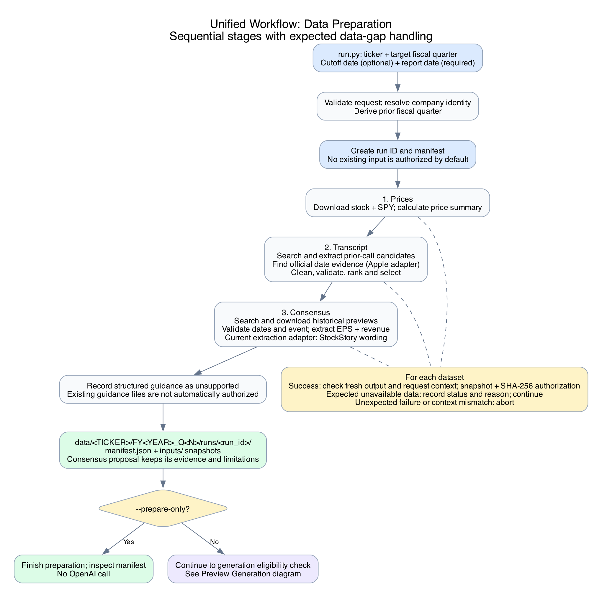
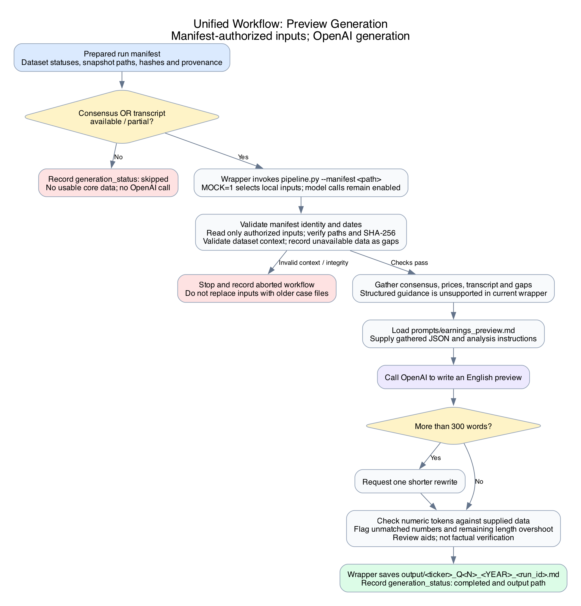

# Earnings Preview Pipeline

Generate a concise earnings preview for sales traders and brokers from market consensus, price action, and the prior earnings call. Compare management guidance with expectations where the available data supports a comparison, and disclose missing information.

This is an MVP with limited source coverage. A valid ticker does not guarantee a complete preview. Expected data gaps are recorded; if neither consensus nor a transcript is usable, generation is skipped without calling OpenAI.

Run commands from the repository root.

## Setup

Python 3.13 or later and `uv` are required:

```bash
uv sync
```

Create a local `.env`:

```dotenv
OPENAI_API_KEY=your_openai_api_key
```

Keep real keys out of version control. The commands below use the installed package name `earnings_preview`; the repository also supports `src.earnings_preview` when launched from its root.

## Quick start: complete workflow

Prepare data and call OpenAI to generate an Apple FY2024 Q4 preview:

```bash
uv run --no-sync --env-file .env python -m earnings_preview.run \
  AAPL "Q4 2024" \
  --as-of 2024-10-30 \
  --report-date 2024-10-31
```

The wrapper resolves the ticker, then prepares prices, the prior-quarter transcript, and consensus sequentially. It runs validation and selection automatically. It stores successful inputs as run-specific snapshots and authorizes their paths and SHA-256 hashes in a manifest before invoking `pipeline.py`.

- `--as-of` is the information cutoff. It defaults to today's date in `Asia/Shanghai`; always provide it for historical tests.
- `--report-date` is required and must be later than the cutoff. Use the actual release date for the target fiscal quarter.
- The target quarter follows the company's fiscal calendar. The prior fiscal quarter is derived automatically.
- `--company-alias` optionally overrides the company alias used for transcript screening.
- Add `--prepare-only` to prepare inputs without calling OpenAI.

Expected unavailable data is recorded and the other datasets continue. Invalid input, unexpected child-command failures, and output context or integrity mismatches stop the workflow. If consensus or a transcript is usable, the model can generate with the remaining gaps disclosed. Prices alone are insufficient.

The wrapper creates:

```text
data/<TICKER>/FY<YEAR>_Q<N>/runs/<run_id>/
├── manifest.json
└── inputs/             # snapshots of successfully authorized inputs

output/<ticker>_Q<N>_<YEAR>_<run_id>.md
```

The manifest records dataset statuses, provenance, and generation outcomes. Expected unavailable states include `missing`, `unsupported`, `unverified`, and `failed`; usable states are `available` and `partial`. Current producers generally authorize complete successful datasets as `available`.

Each invocation retrieves data again and creates a new run. Failed preparation does not authorize an old case input as a replacement. A successful consensus proposal retains its `proposed` status, evidence, and limitations; passing supported checks is not independent verification. The wrapper does not require a manual copy to `consensus.json`.

Structured guidance is currently marked `unsupported` by the wrapper. It does not automatically authorize an existing `guidance.json`. The standalone Microsoft fixture workflow below can still use that file.

Generation calls OpenAI and incurs API charges. `MOCK=1` means read local inputs; it does not disable model calls. The model is asked for an English preview of at most 300 words, with one rewrite attempt if needed. Remaining length overshoots and unmatched numeric tokens are review flags, not guarantees of factual correctness.

## Workflow diagrams

### Data preparation

The unified wrapper runs the stages sequentially. Expected data unavailability is recorded without stopping independent dataset preparation.



[SVG version](docs/diagrams/data-preparation.svg) · [Editable Graphviz source](docs/diagrams/data-preparation.dot)

### Preview generation

This diagram shows the manifest-based path used by the unified wrapper. `agent.py` is a separate tool-calling experiment and is not invoked by this workflow.



[SVG version](docs/diagrams/preview-generation.svg) · [Editable Graphviz source](docs/diagrams/preview-generation.dot)

Assets and regeneration instructions are in [`docs/diagrams/`](docs/diagrams/README.md).

## Standalone commands and local examples

The commands below are useful for inspecting individual stages or reproducing saved fixtures. Direct generation without `--manifest` uses the legacy local-input path and does not apply the wrapper's per-run authorization gate.

### Microsoft FY2024 Q4 local example

This example previews **Microsoft FY2024 Q4**, using a **2024-07-29** data cutoff before the **2024-07-30** earnings release. The source transcript must be **FY2024 Q3**, not the Q4 call that reveals the outcome.

#### 1. Prepare the example data bundle

Place the example files in this exact directory:

```text
data/MSFT/FY2024_Q4/
├── MSFT_daily.csv       # daily prices through 2024-07-29
├── SPY_daily.csv        # benchmark prices through the same cutoff
├── transcript.md        # Microsoft FY2024 Q3 call
├── consensus.json       # FY2024 Q4 expectations known by the cutoff
├── guidance.json        # optional structured Microsoft segment guidance
└── metadata.json        # price-download provenance, when supplied
```

The local summarizer creates `price_action.json`; users do not need to download prices again when the CSVs are supplied. It requires at least 64 trading rows per CSV and a final date of `2024-07-29`.

The current `data/MSFT/FY2024_Q4/` directory contains price files. If your checkout does not yet include `transcript.md`, `consensus.json`, or the optional `guidance.json`, add them from the example bundle before following the generation steps. A directory named `data/msft_fy2024_q4/` is the old layout and is not the directory these commands read.

Keep source URLs, dates, units, and accounting-basis notes with the example data. Do not replace historical consensus with today's estimates. Include only source material that you have permission to redistribute.

#### 2. Rebuild the price summary locally

```bash
uv run --no-sync python -m earnings_preview.prices.summarize
```

This reads the two example CSVs and writes:

```text
data/MSFT/FY2024_Q4/price_action.json
```

This command is currently **specific to the Microsoft FY2024 Q4 example**. It takes no ticker or quarter arguments and performs no network requests. For another company, use the parameterized `prices.download` command below.

#### 3. Check the local inputs without calling a model

```bash
MOCK=1 uv run --no-sync python -c 'from earnings_preview.pipeline import gather; d = gather("MSFT", "Q4 2024", print); print("Data gaps:", d["gaps"]); assert d["consensus"] and d["price_action"] and d["qualitative"], "Complete the example data bundle before generating"'
```

Consensus, price action, and the Q3 transcript should load successfully. If `guidance.json` is absent, the revenue calculation is unavailable and appears under Data gaps; the pipeline can still analyze the transcript.

#### 4. Generate the example preview

```bash
mkdir -p output
MOCK=1 uv run --no-sync --env-file .env python -m earnings_preview.pipeline MSFT "Q4 2024" > output/msft_fy2024_q4_preview.md
```

The note is saved to `output/msft_fy2024_q4_preview.md`; progress and warnings remain in the terminal. This calls OpenAI and overwrites that output filename if it already exists. Use a different filename to keep multiple versions.

The pipeline requests a short English note, checks against 300 words, and attempts one rewrite if needed. A remaining overshoot is flagged rather than blocked. Inspect the note and trace material claims to the saved sources.

### Prepare individual datasets for another company

The parameterized price downloader supports tickers for which Yahoo Finance returns data. Transcript and consensus coverage is more limited; a valid ticker does not guarantee a complete preview.

The commands below use **Apple FY2024 Q4** as a second example:

| Setting | Value |
| --- | --- |
| Ticker | `AAPL` |
| Target fiscal quarter | `Q4 2024` |
| Prior-call fiscal quarter | `Q3 2024` |
| Data cutoff | `2024-10-30` |
| Earnings release date | `2024-10-31` |
| Case directory | `data/AAPL/FY2024_Q4/` |

For another case, replace these values together. Fiscal calendars differ across companies. The price downloader uses `--as-of` to choose historical dates; the quarter argument selects the case directory and does not determine the download period.

#### 1. Download prices and build the summary

```bash
uv run --no-sync python -m earnings_preview.prices.download AAPL "Q4 2024" --as-of 2024-10-30
```

This creates the case directory and saves daily CSVs, `price_action.json`, and download metadata. It already computes the summary, so do not run the Microsoft-specific `prices.summarize` command afterward.

`--as-of` is optional for this downloader and defaults to the current date in `Asia/Shanghai`. Always supply it for historical tests. The actual last trading date is recorded separately, and intraday completeness requires care for current-date runs.

#### 2. Retrieve and select the prior-call transcript

```bash
uv run --no-sync python -m earnings_preview.transcripts.retrieval AAPL "Q4 2024" --source-quarter "Q3 2024"
uv run --no-sync python -m earnings_preview.transcripts.selection AAPL "Q4 2024" --source-quarter "Q3 2024" --company-alias "Apple" --as-of 2024-10-30
```

Retrieval saves candidate drafts and date evidence when available. Selection cleans and revalidates candidates, ranks eligible versions, and writes `transcript.md`, `transcript_metadata.json`, and a selection report. Original drafts remain available.

To inspect validation separately:

```bash
uv run --no-sync python -m earnings_preview.transcripts.validation AAPL "Q4 2024" --source-quarter "Q3 2024" --company-alias "Apple" --as-of 2024-10-30
```

#### 3. Retrieve historical consensus and review the proposal

```bash
uv run --no-sync python -m earnings_preview.consensus.retrieval AAPL "Q4 2024" --as-of 2024-10-30 --report-date 2024-10-31
uv run --no-sync python -m earnings_preview.consensus.validation AAPL "Q4 2024"
```

This saves article text, raw HTML, validation diagnostics, and `consensus_proposed.json`. Review the company, reporting event, publication date, revenue units, EPS basis, source quotations, and stated limitations. Search date hints alone do not establish historical validity.

After reviewing the proposal for this local test, copy it to the pipeline input:

```bash
cp data/AAPL/FY2024_Q4/consensus_proposed.json data/AAPL/FY2024_Q4/consensus.json
```

This replaces the existing consensus input. Keep the evidence and limitations; copying does not make the proposal independently verified.

#### 4. Check inputs and generate

```bash
MOCK=1 uv run --no-sync python -c 'from earnings_preview.pipeline import gather; d = gather("AAPL", "Q4 2024", print); print("Data gaps:", d["gaps"])'
mkdir -p output
MOCK=1 uv run --no-sync --env-file .env python -m earnings_preview.pipeline AAPL "Q4 2024" > output/aapl_fy2024_q4_preview.md
```

Apple does not use the Microsoft segment-sum fixture. A missing supported structured revenue comparison is an expected gap, not permission to invent a guidance range.

## Package layout

```text
src/earnings_preview/
  run.py          # sequential workflow entry point
  pipeline.py     # local-input analysis and generation
  core/           # shared configuration, paths, CLI, statuses, ticker resolution
    __init__.py
    config.py
    path.py
    ticker_resolver.py
    data_status.py
    cli.py
  workflow/       # run records and file authorization
    __init__.py
    run_manifest.py
  transcripts/    # retrieval, call_date, validation, selection
  consensus/      # retrieval, validation
  prices/         # generic download; Microsoft-example summarize
  checks/         # numeric provenance checks
  prompts/
  agent.py
  tools.py
  sources.py
data/<TICKER>/FY<YEAR>_Q<N>/
output/
docs/diagrams/
```

## Current limits

- The call-date adapter currently supports Apple official announcements. Other companies may stop at unsupported or unverified date evidence.
- Consensus extraction currently supports specific StockStory preview wording. Fiscal-quarter mapping depends on the supplied reporting event; arbitrary sources and tickers are not guaranteed.
- Historical article metadata is not an archived point-in-time snapshot.
- Structured revenue-range calculation remains specific to the Microsoft segment fixture. Other cases disclose the missing comparison.
- The unified wrapper enforces per-run input authorization and continues after expected data-unavailability failures. Standalone generation without a manifest remains a separate legacy path.
- The wrapper currently does not register structured guidance, reuse prior runs automatically, or generate a report from prices alone.
- Full arbitrary-company coverage is not implemented. For example, a META run can finish preparation with no usable core data and skip generation.
- Numeric token checks and transcript screening are review aids, not proof of factual accuracy or completeness.
- Sources may reject downloads or rate-limit searches. Retain source evidence and inspect diagnostics rather than silently substituting current data for a historical case.
